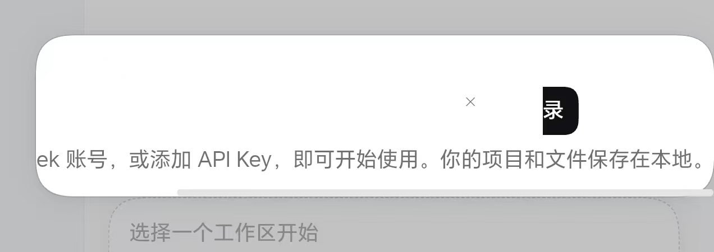
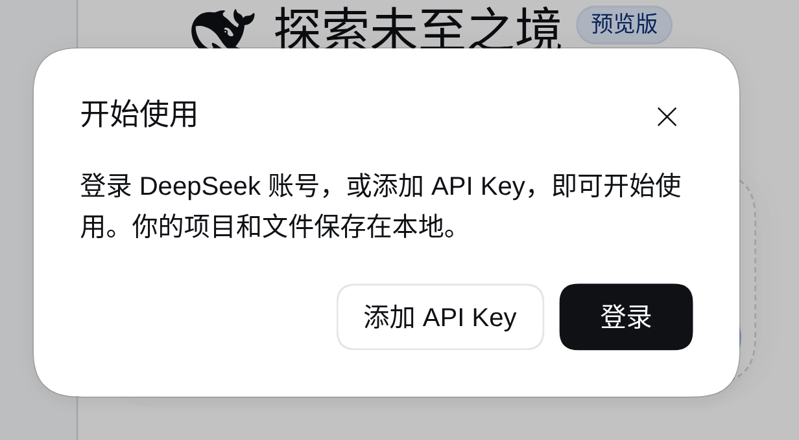

# 登录弹窗渲染错位：WebView 合成层残留（真机记录）

> 手机竖屏首次启动时，DSH Web 的「开始使用 / 登录」弹窗被画坏：卡片横向拉长、纵向截断，
> 标题与按钮消失，「登录」只剩一个「录」字。
> **结论：不是 Web 端 CSS 布局问题，而是 Android WebView 把弹窗的合成层留在了旧的栅格/裁剪状态。**
> 本文记录现象、判定证据、触发链假设与修复；修复代码见 §9（v1.4.3，仍需真机回归确认）。

## 1. 现象

- 白色卡片被画成约 **4.2:1** 的宽扁条（实测 1208 × 287 px）；
- 标题「开始使用」完全不可见；
- 说明文字左侧被裁掉，只剩「ek 账号，或添加 API Key，即可开始使用……」。；
- 「登录」按钮只剩约 20px 宽，可见字符只有「录」（「登录」的第二个字）；
- 卡片左下角外多出一条白色窄条，下方多出一条浅灰圆角条。

## 2. 正确渲染（对照）

生成方式（与手机同一引擎版本 `dsh 0.2.1-rc.2`）：

1. 全新 `DSH_HOME` 起一个隔离实例（无凭证 → 首启即出现登录弹窗）：
   `DSH_HOME=<临时目录> dsh web --port 3099 --no-open --host 127.0.0.1`；
2. Chrome 移动仿真：`400 × 870`、`DPR 3.18`、`is_mobile`；
3. 注入与 App 相同的视口改写（`pageScale = 90` → `initial-scale=0.9`）；
4. 截图后按弹窗区域裁剪。

结果：卡片 **380 × 188**，标题、两行说明、「添加 API Key / 登录」两个按钮全部正常。

## 3. 为什么可以断定不是 CSS 布局问题

三条互相独立的证据：

| 判据 | 真机截图 | 正确渲染 | 结论 |
|---|---|---|---|
| 卡片宽高比 | 1208 × 287（≈ 4.2 : 1） | 380 × 188（≈ 2.0 : 1） | 缩放不会改变宽高比，任何一种页面缩放都得不到 4.2:1 |
| 同一卡片内的缩放 | × 图标 ≈ 1.8×、说明文字 ≈ 2.3×、登录按钮 ≈ 0.2× | 三者同为 1× | 真实 CSS 布局不可能让一张卡片里的元素各用各的缩放 |
| 两次截图 | 用户提供的 jpg / png 逐像素几乎一致 | — | 是稳定残留帧，不是入场动画的瞬间 |

另外，若把卡片高度按「188 CSS px」反推，卡片宽度会得到约 790 CSS px —— 引擎里不存在这种宽度的弹窗
（`Modal` 的 `width: min(380px, 100%)`）。**绘制结果自身不自洽**，说明问题在绘制层而不是布局层。

## 4. 触发链（最可能，待真机确认）

1. App 在 `onPageFinished` 里**事后**用 JS 改写 viewport meta
   （`MainActivity.kt:386` 注入，默认 `DEFAULT_PAGE_SCALE = 90`，见 `MainActivity.kt:1665`）。
   此时页面已经按 `width=device-width, initial-scale=1` 完成首次布局与首帧绘制，
   改写后布局宽度 400 → 444 CSS px、整页缩放突变。
2. 登录弹窗恰好出现在这个时间点（首次启动没有凭证）。它带
   `backdrop-filter` 模糊遮罩 + 圆角 `overflow:hidden` 卡片 + `modalEnter` 淡入动画
   （引擎 `packages/client/ui-primitives/src/Modal.module.css`），会被提升为独立合成层。
   缩放/布局突变时这些层没有完整重栅格化，于是出现「旧尺寸的卡片背景 + 新位置的文字/按钮」混排。
3. 还有两条可能把旧帧「冻住」的路径：
   - `onResume` 里缩放偏好变化时 `webView.reload()`（`MainActivity.kt:207`）；
   - 渲染进程回收/看门狗触发 `recoverWebView()` 重建 WebView（`MainActivity.kt:1293`）。
4. 华为设备自带的 WebView 版本通常落后于 Chrome，会放大这类合成 bug（本次设备 HUAWEI AAK-AN00）。

## 5. 影响面

- 首启无凭证时的登录弹窗，概率最高；任何「页面缩放刚变更 / WebView 刚重建」之后出现的浮层理论上有同样风险。
- **功能未损坏**：DOM 与点击区域仍在，只是被绘制到错误位置，因此按钮很难点中。
- 环境：HUAWEI AAK-AN00，竖屏，引擎 `dsh 0.2.1-rc.2`。

## 6. 临时规避

- 点工具栏「重启」（引擎 stop → start，页面整页重绘）；
- 旋转屏幕（触发 reload，`MainActivity.kt:495`）；
- 关闭弹窗再打开。

若重载后恢复正常，即可确认是绘制残留而非真实布局错误。

## 7. 修复方案

| 方案 | 做法 | 优点 | 代价 |
|---|---|---|---|
| A | `WebViewClient.shouldInterceptRequest` 拦截主文档 HTML，在 `<head>` 里直接插入带 `initial-scale` 的 meta | 首帧即最终缩放，彻底去掉「加载后缩放」；对其它浮层一并生效 | 需在后台线程读改写主文档响应，注意 token / 编码 / 非 HTML 响应 |
| B | 新增窄屏客户端 UI 插件：关掉该弹窗的 `backdrop-filter` 与入场动画（去合成层），并补窄屏 `max-width` | 与 `narrow-*` 插件同一机制，不碰引擎源码、可回滚；顺带降低手机上模糊层的开销 | 改变视觉效果（遮罩不再模糊） |
| **C（已实现）** | 把视口改写移到启动遮罩收起**之前**，随后在遮罩之下切换一次 `setLayerType` 强制整页重栅格化 | 改动小、无用户可见闪烁；覆盖「旧栅格 + 新缩放」这一直接成因 | 若根因另有其因（如 `backdrop-filter` 合成 bug 与缩放无关），需 A/B 兜底 |

## 8. 待验证

- [ ] 是否每次首启必现；重启/旋转后是否恢复；
- [ ] 手机重连无线 adb 后 dump WebView 可访问性树，确认标题/按钮的 DOM 位置正常（进一步坐实「绘制错位」）；
- [ ] 本修复（§9）在真机上的实际效果；把页面缩放调到 100%（`scale=1` 时跳过重栅格化）是否仍能复现。

## 9. 修复（本 PR 附带，v1.4.3）

改动只在 `MainActivity.kt`，共三处：

1. **顺序**：`onPageFinished` 里先 `applyViewport(view)`，再 `dismissSplash()`。
   旧顺序是「先收遮罩、再改 meta」——用户会先看到按 `initial-scale=1` 画好的首屏
   （登录弹窗就在这一帧），紧接着整页缩放突变，WebView 把部分合成层留在旧栅格，
   于是出现本文截图里的错位。v1.3.1 的「收遮罩必须在模式分支之前」约束仍然满足：
   两个渲染分支（桌面 / 竖屏）都走完 `applyViewport` 才收遮罩，没有提前 return。
2. **整页重栅格化**：`scheduleReraster()` 在视口 meta 应用后等待
   `VIEWPORT_SETTLE_MS = 120ms`（让渲染进程完成重排/缩放），切到
   `LAYER_TYPE_SOFTWARE` 丢弃全部缓存栅格并整页重绘，再切回 `LAYER_TYPE_NONE`
   恢复硬件合成。两次切换都在 `dismissSplash()` 的等待窗口内完成
   （遮罩至少 `splashMinMs(700ms) + 180ms` 后才开始淡出），用户看不到软件渲染帧。
3. **范围**：桌面模式（`width=1280`）同样需要重栅格化；竖屏 `scale=1` 时没有缩放突变，
   跳过重栅格化，避免无谓开销。每次重栅格化都会在 `engine.log` 写一行
   `reraster: <reason>`，便于真机核对是否命中。

修复后的预期：用户看到的第一帧就是最终缩放；即使登录弹窗在缩放之后才绘制，
它也会直接以最终缩放绘制，不会再出现「卡片背景与文字各用各的缩放」。

> ⚠️ 本修复尚未在真机回归（提交时设备不在线）。若真机仍复现，说明根因是
> WebView 自身的 `backdrop-filter` 合成行为（与缩放时机无关），应改用方案 B
> （窄屏客户端插件去掉模糊层与入场动画）兜底。

## 附：可复用的判定方法

遇到「弹窗/浮层看起来被拉扁/错位」时，先量三个数：卡片宽高比、同一卡片内不同元素的缩放比、
两次截图的差异。三者只要互相矛盾，就应优先怀疑 WebView 合成/栅格，而不是去改 CSS。
